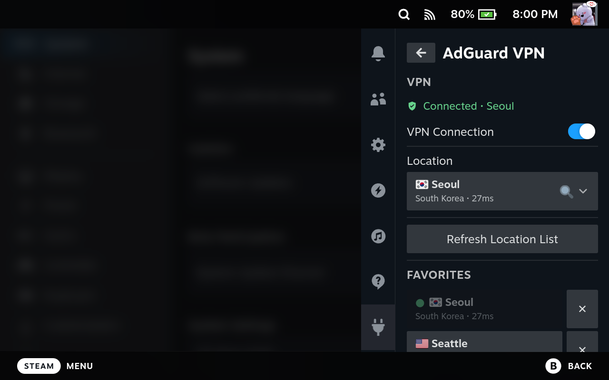

# AdGuard VPN for Decky (Unofficial)

[English](#adguard-vpn-for-decky-unofficial) · [한국어](#한국어)

A Decky Loader plugin that turns AdGuard VPN on and off and picks a location from the Steam Deck Quick Access menu, using AdGuard's official CLI (`adguardvpn-cli`). The panel follows your Steam language: Korean, or English for every other language.

> **This is an unofficial plugin.** It is a personal project, not affiliated with, endorsed by, or supported by AdGuard. Please report plugin problems to the author (gomburger), not to AdGuard.

## Requirements

- A Steam Deck in Game Mode
- [Decky Loader](https://decky.xyz/)
- An AdGuard account (free accounts work too)

## Install

1. Download `decky-adguard-vpn-<version>.zip` from the [releases page](https://github.com/gomburger/decky-adguard-vpn/releases/latest) to your Steam Deck.
2. Turn on Developer Mode in Decky's settings.
3. In Decky's **Developer** menu, choose **Install Plugin from ZIP File** and pick the downloaded file.

Install updates the same way. Your login, favorites, and settings are kept.

## Quick Start

1. Open the Quick Access menu (`…` button) and go to **Decky → AdGuard VPN**.
2. Press **Install AdGuard VPN CLI**. The CLI is downloaded from AdGuard's official GitHub, and its signature is checked before it is installed.
3. Press **Log In** and sign in by scanning the QR code with your phone, or with **Open in Browser**. The panel continues on its own when you finish.
4. Turn on **VPN Connection**.

## Locations and Favorites

**Location**: Opens the location picker. The search box takes a city, a country name (Korean or English), or a country code. **⚡ Fastest Location** is focused first.

- Picking a location only remembers it for the next connection. While connected, it switches right away.
- You can add or remove favorites right in the picker. Favorites are listed at the top.
- **Refresh Location List** reloads the list and the ping times.

**Favorites**: Choose a favorite location in one press, remove it, or change the order of your favorites.

## Settings

- **Auto-Connect**: Connects to the last location when Steam starts.
- **Log Out**: Signs out of your AdGuard account.

## AdGuard VPN CLI

The plugin does not include the CLI. It installs AdGuard's official CLI into its own folder and shows the installed version at the bottom of the panel, with whether AdGuard's official signature was verified.

- **Install**: **Install AdGuard VPN CLI** downloads the latest release for this device from AdGuard's official GitHub. Before installing, it checks the signature (`adguardvpn-cli.sig`) with `gpgv` against AdGuard's signing key bundled with the plugin. If the signature does not match, it stops and leaves the current CLI as it was.
- **Updates**: The plugin checks for a new CLI when Steam starts, and again when you open the panel if the last check is more than 6 hours old. A new version shows a notice at the top of the panel. Updating checks the signature, and if the VPN was on, it reconnects after a short break.
- **Check for Updates**: Checks right away.
- **Verify Signature and Reinstall**: Shown when the plugin has not verified the installed CLI's signature, for example a CLI installed by an older plugin version or copied into the plugin's folder by hand.
- **Remove AdGuard VPN CLI**: Disconnects, logs out, and deletes the CLI, your login, and the CLI settings. Favorites and Auto-Connect are kept.

## Troubleshooting

| Symptom | What to try |
|---|---|
| "Installation stopped" with a signature message | Try again later. If it keeps happening, the download may be damaged or tampered with; do not install the file by hand. |
| "Login timed out" | Press **Log In** again and finish within the time shown. |
| "Connection failed" | Choose **⚡ Fastest Location** or another location, or press **Refresh Location List**. |
| "Could not check for updates" | Check the network. GitHub may also be limiting requests; try again later. |
| "AdGuard official signature not verified" | The plugin has not verified this CLI's signature. Press **Verify Signature and Reinstall**. |

## Known Limitations

- System-wide VPN (TUN mode) needs administrator rights, so the plugin **runs as root**.
- The CLI is not included in this plugin. It is downloaded from AdGuard's official releases when you press Install, and AdGuard's terms apply to it.
- Steam updates may change the Quick Access menu's layout, which can affect the size of the location picker.

## How It Works and Privacy

The plugin runs AdGuard's official CLI and shows its state in the panel. While the VPN is on, the CLI routes the system's traffic and DNS through AdGuard; the plugin's own files stay in the folders below.

- Network: the plugin itself only contacts GitHub, to check for and download the CLI. The VPN connection and login go through the CLI to AdGuard.
- Stored on this device: login and CLI settings in `~/homebrew/settings/decky-adguard-vpn/`, the CLI in `~/homebrew/data/decky-adguard-vpn/`, and logs in `~/homebrew/logs/decky-adguard-vpn/`. Your account email, plan, and connection state are cached there so the panel opens instantly.
- Logs hide your email address and login code.

## License

MIT, Copyright (c) 2026 gomburger. See [LICENSE](LICENSE) for details and third-party notices. "AdGuard" is a trademark of its owner.

---

# 한국어

Steam Deck의 Quick Access 메뉴에서 AdGuard 공식 VPN CLI(`adguardvpn-cli`)로 AdGuard VPN을 켜고 끄고 위치를 고르는 Decky Loader 플러그인입니다. 화면 언어는 Steam 언어를 따릅니다(한국어, 그 외 언어는 영어).

> **비공식 플러그인입니다.** AdGuard와 관련이 없고 AdGuard의 승인이나 지원을 받지 않은 개인 제작 플러그인입니다. 플러그인 문제는 AdGuard가 아니라 제작자(gomburger)에게 알려 주세요.

## 필요한 것

- 게임 모드로 실행 중인 Steam Deck
- [Decky Loader](https://decky.xyz/)
- AdGuard 계정 (무료 계정도 가능)

## 설치

1. [릴리스 페이지](https://github.com/gomburger/decky-adguard-vpn/releases/latest)에서 `decky-adguard-vpn-<version>.zip`을 Steam Deck에 내려받습니다.
2. Decky 설정에서 개발자 모드를 켭니다.
3. Decky 설정의 **개발자** 메뉴에서 **ZIP으로 플러그인 설치**를 선택하고 내려받은 파일을 고릅니다.

업데이트도 같은 방법으로 설치하면 됩니다. 로그인, 즐겨찾기, 설정은 유지됩니다.

## 빠른 시작

1. Quick Access 메뉴(`…` 버튼)에서 **Decky → AdGuard VPN**을 엽니다.
2. **AdGuard VPN CLI 설치**를 누릅니다. AdGuard 공식 GitHub에서 내려받아 서명을 확인한 뒤 설치합니다.
3. **로그인**을 누르고 휴대폰으로 QR 코드를 찍거나 **브라우저에서 열기**로 로그인합니다. 완료되면 패널이 자동으로 넘어갑니다.
4. **VPN 연결**을 켭니다.

## 위치와 즐겨찾기

**위치**: 위치 선택 창을 엽니다. 검색창에는 도시, 나라 이름(한글/영문), 국가 코드를 입력할 수 있습니다. 처음에는 **⚡ 가장 빠른 위치**에 커서가 있습니다.

- 위치를 고르면 다음 연결에 쓸 위치로 기억합니다. 연결된 상태에서는 바로 그 위치로 전환합니다.
- 위치 선택 창에서 바로 즐겨찾기에 추가하거나 해제할 수 있습니다. 즐겨찾기는 목록 맨 위에 나옵니다.
- **위치 목록 새로고침**: 위치 목록과 핑을 다시 불러옵니다.

**즐겨찾기**: 즐겨찾기한 위치를 한 번에 고르거나, 즐겨찾기에서 빼거나, 순서를 바꿀 수 있습니다.

## 설정

- **자동 연결**: Steam이 시작될 때 마지막 위치로 연결합니다.
- **로그아웃**: AdGuard 계정에서 로그아웃합니다.

## AdGuard VPN CLI

CLI는 플러그인에 들어 있지 않습니다. 플러그인이 AdGuard 공식 CLI를 자기 폴더에 설치하고, 패널 맨 아래에 설치된 버전과 AdGuard 공식 서명 확인 여부를 표시합니다.

- **설치**: **AdGuard VPN CLI 설치**를 누르면 AdGuard 공식 GitHub에서 이 기기에 맞는 최신 릴리스를 내려받습니다. 설치하기 전에 플러그인에 들어 있는 AdGuard 서명 키로 서명 파일(`adguardvpn-cli.sig`)을 `gpgv`로 확인하고, 서명이 맞지 않으면 설치를 멈추고 기존 CLI를 그대로 둡니다.
- **업데이트**: Steam이 시작될 때, 그리고 패널을 열 때 마지막 확인에서 6시간이 지났으면 새 CLI 버전을 확인합니다. 새 버전이 있으면 패널 맨 위에 안내가 나타납니다. 업데이트할 때도 서명을 확인하며, VPN이 켜져 있었다면 잠시 끊겼다가 다시 연결합니다.
- **업데이트 확인**: 바로 확인합니다.
- **서명 확인하고 다시 설치**: 플러그인이 설치된 CLI의 서명을 확인하지 않은 경우에 나타납니다. 이전 플러그인 버전으로 설치했거나 플러그인 폴더에 CLI를 직접 복사한 경우입니다.
- **AdGuard VPN CLI 제거**: VPN 연결을 끊고 로그아웃한 뒤 CLI와 로그인 정보, CLI 설정을 지웁니다. 즐겨찾기와 자동 연결 설정은 남습니다.

## 문제 해결

| 증상 | 해 볼 것 |
|---|---|
| 서명 관련 문구와 함께 "설치를 중단했습니다"가 보임 | 잠시 뒤 다시 시도합니다. 계속되면 내려받은 파일이 손상되었거나 바뀌었을 수 있으니 파일을 직접 설치하지 마세요. |
| "로그인 시간이 초과되었습니다" | **로그인**을 다시 누르고 시간 안에 로그인을 마칩니다. |
| "연결 실패" | **⚡ 가장 빠른 위치**나 다른 위치를 고르거나 **위치 목록 새로고침**을 누릅니다. |
| "업데이트 확인 실패" | 네트워크를 확인합니다. GitHub가 요청을 제한했을 수도 있으니 잠시 뒤 다시 시도합니다. |
| "AdGuard 공식 서명 확인 안 됨" | 플러그인이 이 CLI의 서명을 확인하지 않은 상태입니다. **서명 확인하고 다시 설치**를 누릅니다. |

## 알려진 제한

- 시스템 전체 VPN(TUN 모드)을 쓰려면 관리자 권한이 필요해서 플러그인이 **root로 실행**됩니다.
- AdGuard VPN CLI는 이 플러그인에 들어 있지 않습니다. 설치를 누르면 AdGuard 공식 릴리스에서 받아 오며, CLI 사용에는 AdGuard의 약관이 적용됩니다.
- Steam 업데이트로 Quick Access 메뉴의 구조가 바뀌면 위치 선택 창의 크기가 어긋날 수 있습니다.

## 작동 방식과 개인정보

AdGuard 공식 CLI를 실행하고 그 상태를 패널에 보여 줍니다. VPN이 켜져 있는 동안 CLI가 시스템의 트래픽과 DNS를 AdGuard로 보내고, 플러그인 자체의 파일은 아래 폴더에만 둡니다.

- 네트워크: 플러그인 자체는 CLI 업데이트 확인과 내려받기를 위해 GitHub에만 접속합니다. VPN 연결과 로그인은 CLI가 AdGuard와 직접 처리합니다.
- 이 기기에 저장하는 것: 로그인 정보와 CLI 설정은 `~/homebrew/settings/decky-adguard-vpn/`, CLI는 `~/homebrew/data/decky-adguard-vpn/`, 로그는 `~/homebrew/logs/decky-adguard-vpn/`에 저장합니다. 패널을 바로 열 수 있도록 계정 이메일, 요금제, 연결 상태를 이곳에 캐시합니다.
- 로그에는 이메일 주소와 로그인 코드를 가려서 남깁니다.

## 라이선스

MIT, Copyright (c) 2026 gomburger. 자세한 내용과 제3자 고지는 [LICENSE](LICENSE)를 참고하세요. "AdGuard"는 해당 소유자의 상표입니다.
