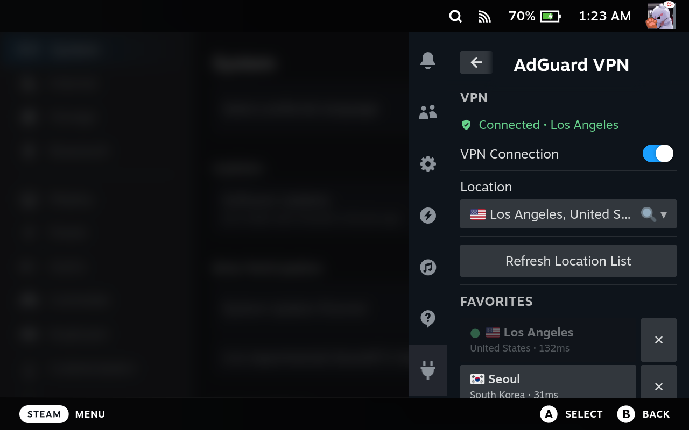

# AdGuard VPN for Decky (Unofficial)

[English](#adguard-vpn-for-decky-unofficial) · [한국어](#한국어)

> **This is an unofficial plugin.** It is a personal project, not affiliated with, endorsed by, or supported by AdGuard. Please report plugin problems to the author (gomburger), not to AdGuard.

A [Decky Loader](https://decky.xyz) plugin for turning AdGuard VPN on and off and choosing a location from the Steam Deck Quick Access (…) menu, using AdGuard's official CLI (`adguardvpn-cli`). The panel follows your Steam language: Korean, or English for every other language.

## Features

- Connect and disconnect, location picker with search, favorites
- Login QR code you can scan with a phone
- Auto-connect when Steam starts
- Install, update, and remove the CLI. Installs and updates **check AdGuard's official signature** and stop if it does not match.

## Install

1. In Decky Loader settings, go to Developer and choose **Install Plugin from ZIP File**, then pick `decky-adguard-vpn-<version>.zip` from [Releases](https://github.com/gomburger/decky-adguard-vpn/releases).
2. Open Quick Access → Plugins → **AdGuard VPN**.
3. Press **Install AdGuard VPN CLI**. It is downloaded from AdGuard's official GitHub and its signature is checked.
4. Press **Log In** and sign in to your AdGuard account with the QR code or link. Free accounts work too.

## Good to know

- System-wide VPN (TUN mode) needs administrator rights, so the plugin **runs as root**.
- AdGuard VPN CLI is not included in this plugin. It is downloaded from AdGuard's official releases when you press Install, and AdGuard's terms apply to it.
- Login and settings are stored in `~/homebrew/settings/decky-adguard-vpn/`, the CLI in `~/homebrew/data/decky-adguard-vpn/`, and logs in `~/homebrew/logs/decky-adguard-vpn/`.
- SSH from the same local network usually keeps working. SSH coming in from outside through port forwarding drops while the VPN is on.

## License

MIT License, Copyright (c) 2026 gomburger. See [LICENSE](LICENSE) for details and third-party notices. "AdGuard" is a trademark of its owner.

---

# 한국어

> **비공식 플러그인입니다.** AdGuard와 관련이 없고 AdGuard의 승인이나 지원을 받지 않은 개인 제작 플러그인입니다.
> 플러그인 문제는 AdGuard가 아니라 제작자(gomburger)에게 알려 주세요.

Steam Deck의 Quick Access(…) 메뉴에서 AdGuard 공식 VPN CLI(`adguardvpn-cli`)로 VPN을 켜고 끄고 위치를 고르는 [Decky Loader](https://decky.xyz) 플러그인입니다. 화면 언어는 Steam 언어를 따릅니다(한국어, 그 외 언어는 영어).

## 기능

- VPN 연결/해제, 위치 선택(검색 지원), 즐겨찾기
- 휴대폰으로 찍을 수 있는 로그인 QR 코드
- Steam 시작 시 자동 연결
- CLI 설치·업데이트·제거. 설치와 업데이트 때 **AdGuard 공식 서명을 확인**하고, 맞지 않으면 설치하지 않습니다.

## 설치

1. Decky Loader 설정 → 개발자 → **Install Plugin from ZIP File**에서 [Releases](https://github.com/gomburger/decky-adguard-vpn/releases)에서 받은 `decky-adguard-vpn-<version>.zip`을 고릅니다.
2. Quick Access 메뉴 → 플러그인 → **AdGuard VPN**을 엽니다.
3. **AdGuard VPN CLI 설치**를 누릅니다. AdGuard의 공식 GitHub에서 받아 서명을 확인한 뒤 설치합니다.
4. **로그인**을 누르고 QR 코드나 링크로 AdGuard 계정에 로그인합니다. 무료 계정도 쓸 수 있습니다.

## 알아 두기

- 시스템 전체 VPN(TUN 모드)을 쓰려면 관리자 권한이 필요해서 플러그인이 **root로 실행**됩니다.
- AdGuard VPN CLI는 이 플러그인에 들어 있지 않습니다. 사용자가 설치를 누르면 AdGuard 공식 릴리스에서 받아 오며, CLI 사용에는 AdGuard의 약관이 적용됩니다.
- 로그인 정보와 설정은 `~/homebrew/settings/decky-adguard-vpn/`에, CLI는 `~/homebrew/data/decky-adguard-vpn/`에, 로그는 `~/homebrew/logs/decky-adguard-vpn/`에 저장됩니다.
- 같은 네트워크(LAN)에서 들어오는 SSH는 보통 유지되지만, 외부에서 포트포워딩으로 들어오는 SSH는 VPN이 켜져 있으면 끊깁니다.

## 라이선스

MIT License, Copyright (c) 2026 gomburger. 자세한 내용과 제3자 고지는 [LICENSE](LICENSE)를 보세요.
"AdGuard"는 해당 소유자의 상표입니다.
